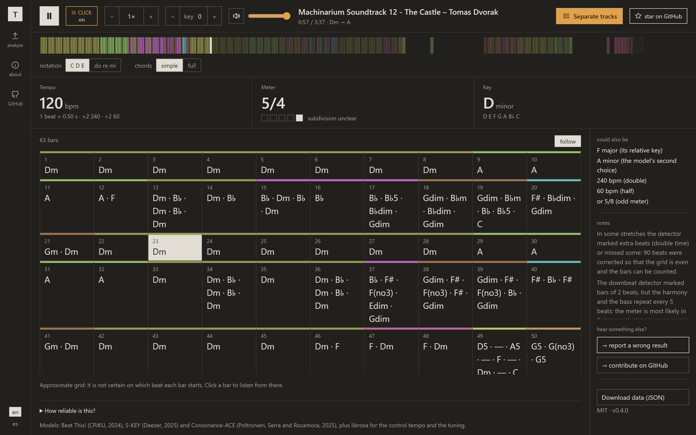
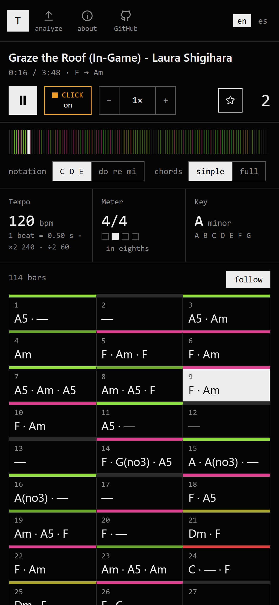

# Tonos

**The tempo, meter, key and chords of a song, bar by bar, worked out on your own computer.**

<p>
  <a href="https://joaquinmuzzi.github.io/Tonos/"></a>
  <a href="#installation"></a>
</p>

[](https://github.com/joaquinmuzzi/tonos/actions/workflows/tests.yml)
[](LICENSE)

Drop in an audio or video file (MP4, MP3, M4A, WAV, FLAC, MKV…) and Tonos shows its chords on a
bar-by-bar grid, with a player that follows the song and an optional click on every beat, so you
can check the analysis by ear.

<!-- Demo recording: uncomment once docs/demo.gif exists.
<p align="center">
  
</p>
-->

<p align="center">
  
  
</p>

## Why Tonos?

- **Local and private.** The analysis runs on your computer and your files are never uploaded.
  The internet is only used once, to download the models.
- **Odd meters too.** Besides 3/4, 4/4 and 6/8, it finds 5/4 and 7/4 when the harmony repeats
  clearly, and it marks the grid as approximate when it is not sure where each bar starts.
- **Chords spelled for the key.** In F major you read B♭, not A♯, in letter names (C D E) or in
  solfège (Do Re Mi).
- **In Spanish.** The web app is in Spanish as well as English.
- **Says when it is unsure.** In styles that move between 3/4 and 6/8, like the chacarera or the
  zamba, it shows both readings instead of picking one in silence. Its models learned mostly from
  pop and rock, so folk and Latin American genres are worth checking by ear: see
  [how reliable it is](#how-reliable-it-is).

> [!IMPORTANT]
> **Model licensing.** The code in this repository is MIT-licensed, but the analysis relies on
> third-party model weights with their own terms: the S-KEY weights have no stated licence, and
> the Consonance-ACE weights were trained on third-party annotation datasets that may restrict
> commercial use. This project is intended for personal, local use. Commercial use of the models
> is not confirmed and may require review. See [License](#license) and
> [THIRD_PARTY_NOTICES.md](THIRD_PARTY_NOTICES.md).

## Features

- **Tempo** in BPM, with its double and half, a tempo curve and a warning when the tempo drifts.
- **Meter** (3/4, 4/4, 6/8, 5/4, 7/4…), with how sure it is and the readings it could be confused
  with. Odd meters are found from how often the harmony repeats.
- **Key**, with the notes of its scale, the relative key and the model's second choice, possible
  key changes, and a warning when the recording is not tuned to A = 440 Hz.
- **Chords**, one per beat, in letter names (C D E) or solfège (Do Re Mi), in a simple
  major/minor mode or with sevenths, basses and inversions.
- A **player** with a **click** on every beat (and a light that blinks with it), a speed control
  from 0.5× to 1.5×, a timeline coloured by chord, and a **bar-by-bar grid** you can click to
  play from any bar.
- A **command line** that prints a text report or the full JSON.

## Installation

### Windows

You need Python 3.12, [ffmpeg](https://ffmpeg.org/) and git. If one is missing, the installer
tells you the `winget` command to install it. Then, in a terminal inside this folder:

```powershell
.\install.ps1
```

It takes a few minutes and uses about 1.5 GB in `%LOCALAPPDATA%\tonos\venv`.

### macOS and Linux

You need Python 3.12, [ffmpeg](https://ffmpeg.org/) and git. If one is missing, the installer
tells you the `brew` (macOS) or `apt` (Debian, Ubuntu) command to install it. Then, in a terminal
inside this folder:

```bash
./install.sh
```

It takes a few minutes and uses about 1.5 GB in `~/.local/share/tonos/venv`. On a Mac it needs
Apple silicon: PyTorch has no current build for Intel Macs. Ubuntu releases newer than 24.04 do
not package Python 3.12; the [deadsnakes PPA](https://launchpad.net/~deadsnakes/+archive/ubuntu/ppa)
has it.

Running either installer again updates the environment instead of creating it from scratch.

## Usage

- **Web app:** double-click `tonos.bat` on Windows, or run `./tonos.sh` on macOS and Linux. The
  browser opens at http://127.0.0.1:8765. Close the window (or press Ctrl+C) to stop it; if it is
  already running, only the browser opens. You can drop a file anywhere on the page, even over a
  report.
- **Command line:** `tonos.bat "C:\path\to\song.mp4"` or `./tonos.sh path/to/song.mp4` prints a
  text report; add `--json` for all the data or `--lab` for a tab-separated chord annotation file compatible\n  with music-research tools such as mir_eval and Sonic Visualiser. `--help` lists every option.

An analysis takes 10 to 30 seconds per song. Uploading the same file again gives the result
instantly, because it is cached. What changed in each version is in [CHANGELOG.md](CHANGELOG.md).

## How reliable it is

| What | Reliability | How it is computed |
|---|---|---|
| Tempo and beats | High for music with drums; the typical error is double or half the tempo | Beat This! (CPJKU, 2024), checked against a second method (librosa) |
| Meter | Medium for 3/4 and 4/4; finds 5/4 and 7/4 when the harmony repeats clearly | Counts the beats between downbeats, checks it against how often the harmony and the bass repeat, and looks at whether each beat divides into 2 or 3 |
| Key | Medium: exact for 7 or 8 songs out of 10; when wrong, usually the relative key or a fifth | S-KEY (Deezer, 2025), checked against a second method based on the chords |
| Chords | Medium: about 78 % of the time for major/minor, less with sevenths | Consonance-ACE (2025), one chord per beat |

Things to keep in mind:

- **3/4 and 6/8 cannot be told apart automatically.** Some styles, like the chacarera or the
  zamba, alternate them on purpose.
- **Bars of 5 and 7:** the downbeat detector barely saw them during training and forces them
  into 4, so a second method measures how often the harmony repeats. When it is not clear on
  which beat each bar starts, the grid is marked as approximate.
- **The models were trained mostly on pop and rock sung in English.** Folk, tango and other
  Latin American genres may give worse results.
- **One key per song,** although the app warns when it finds a long stretch in another key.

## How it works

1. **Audio:** ffmpeg extracts the first non-silent audio track as a mono 22.05 kHz WAV.
2. **Beats and downbeats:** Beat This! marks them; Tonos then evens out the grid (double-time
   stretches, missed beats, mis-tracked fills) without touching real tempo changes.
3. **Tempo** comes from the mean beat interval, and is compared with librosa's estimate.
4. **Meter:** the beats between downbeats are counted, and a second method measures how
   similar the harmony, the bass and the accents are to themselves 3, 4, 5 or 7 beats later.
5. **Key:** S-KEY on the whole song and on 30-second windows, plus a key profile built from the
   chords.
6. **Chords:** Consonance-ACE on 20-second chunks, reduced to one chord per beat and spelled
   according to the key (B♭ in F major, not A♯; D/F♯, not D/G♭).

The code is in [`tonos/analysis`](tonos/analysis), one module per step.

## Where it stores things

- `%LOCALAPPDATA%\tonos\venv` on Windows, `~/.local/share/tonos/venv` on macOS and Linux: the
  Python environment the installers create.
- `%LOCALAPPDATA%\tonos\cache` (`~/.cache/tonos/cache` on macOS and Linux): finished analyses,
  small JSON files.
- `~/.cache/torch/hub/checkpoints/beat_this-final0.ckpt`: the beat model (77 MB).

To uninstall, delete those and this folder. Versions before 0.1.0 used
`%LOCALAPPDATA%\analizador-musical`, which can be deleted too; version 0.1.0, called orfeo, used
`%LOCALAPPDATA%\orfeo`, which `install.ps1` renames.

## Contributing

Bug reports, wrong results and pull requests are welcome: see [CONTRIBUTING.md](CONTRIBUTING.md)
for how to set up a development environment, run the tests and write commits. Please follow the
[Code of Conduct](CODE_OF_CONDUCT.md), and report security issues as described in
[SECURITY.md](SECURITY.md).

Ideas for the future:

- **Sections** (intro, verse, chorus), for example with SongFormer.
- **Instrument separation** with Demucs, to analyze the bass or the harmony on their own.
- **Questions in natural language** about a song, by passing the analysis JSON to a language model.

## License

The source code of this project is released under the [MIT License](LICENSE).

The machine-learning models it uses are separate works with their own terms, and this repository
does not include their weights; they are installed from their original sources:

- **Beat This!** (beats and downbeats): code and weights released under MIT by their authors.
- **S-KEY** (key): MIT code; **no licence is stated for the weights**.
- **Consonance-ACE** (chords): MIT code; the weights were trained on third-party chord annotation
  datasets whose terms **may restrict commercial use**.

Because of this, Tonos is intended for **personal, local use**. Commercial use of the model
weights is not confirmed: if you plan to use this project commercially, review each model's
licence and training-data terms first. Details, library licences and citations are in
[THIRD_PARTY_NOTICES.md](THIRD_PARTY_NOTICES.md). This is not legal advice.
